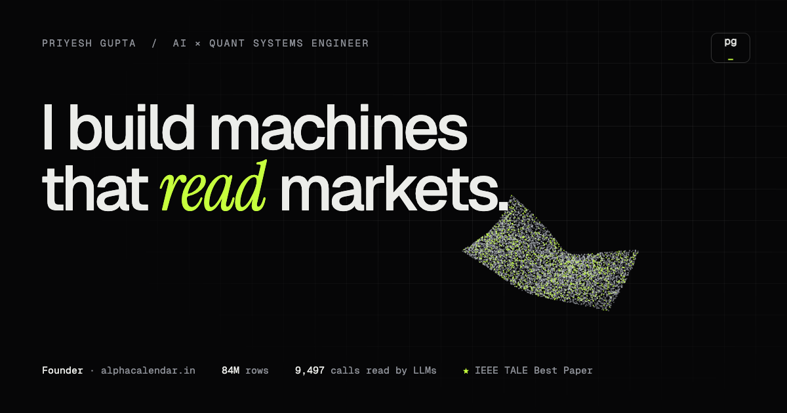

# Priyesh Gupta | I build machines that read markets

[](https://priyeshgupta.netlify.app)

Personal site of Priyesh Gupta, AI × quant systems engineer and founder of [AlphaCalendar](https://alphacalendar.in). Designed and engineered from scratch.


## What's inside

- **WebGL particle field** (Three.js + custom GLSL): 26k points morph between an implied-vol surface (raw SVI), a neural lattice, a latent embedding space and a price path. The field reacts to the cursor, and the HUD reports live fps and coordinates.
- **AlphaCalendar flagship**: a browser frame that tilts in on scroll, count-up metrics, an animated data-pipeline diagram with a 15-gate validation harness, and a full [engineering case study](https://priyeshgupta.netlify.app/work/alphacalendar/).
- **Systems as model cards**: each project has a live canvas sketch of what it does (RAG retrieval, SVI fit, risk-gated event bus, XBRL audit, DTW alignment, and more) and opens into a detail modal.
- **Career as `git log --graph`**: research and industry branches merging into main.
- **⌘K command palette**, an **interactive terminal** (`help`, `neofetch`, `cat options-lab`, `sudo hire priyesh`), a **pinned horizontal build log**, and a contact form styled as an API request.
- **1-bit dithered portrait** with an x-ray lens that reveals the photo.
- Dark and light themes, Lenis smooth scroll, reduced-motion support, static export.

## Layout

```
site/      Next.js 16 app (static export → site/out)
resume/    ATS résumé + CV (.pdf, .docx) and their generator (content.mjs → build.mjs)
netlify.toml   builds from /site
```

## Run

```bash
cd site
npm install
npm run dev      # http://localhost:3000
npm run build    # static export to site/out
```

All site copy lives in `site/src/content/data.ts`.

## Résumé / CV

Edit `resume/content.mjs`, then from a folder with `docx` and `playwright-core` installed run `node build.mjs <outdir>`. It prints the PDFs through Chromium (selectable text, single column, ATS-safe) and writes matching `.docx` files. Copy the PDFs into `site/public/` to update the site's download links.

## Deployment

Netlify, configured by `netlify.toml` (base `site`, publish `out`). Live at [priyeshgupta.netlify.app](https://priyeshgupta.netlify.app).

## License

[MIT](LICENSE)
